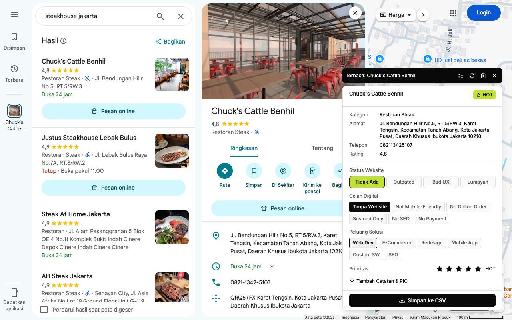
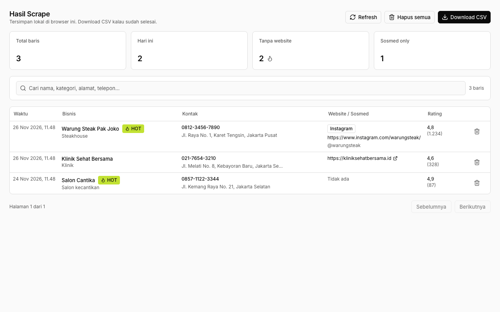

# Panduan SDR — SDR Lead Capture

Panduan ini dibuat untuk tim SDR. Tidak perlu paham coding atau istilah teknis.
Ikuti langkahnya dari atas ke bawah.

**Alat ini gunanya:** mengambil nama bisnis, alamat, telepon, dan kategori dari
Google Maps, lalu menyimpannya jadi satu file yang bisa dibuka di Excel atau
Google Sheets.

---

## 1. Pasang sekali saja

> Sudah dipasang oleh admin? Lewati ke bagian **2. Ambil satu bisnis**.

1. Minta file **`sdr-lead-capture-1.0.7-chrome.zip`** ke admin.
2. **Extract** file itu ke folder yang mudah diingat, misalnya
   `Dokumen/SDR Lead Capture`.
   **Jangan hapus folder ini** setelah dipasang.
3. Buka Chrome, ketik di address bar: `chrome://extensions`
4. Nyalakan **Developer mode** di kanan atas.
5. Klik **Load unpacked**, lalu pilih folder hasil extract tadi.
6. Klik ikon puzzle 🧩 di kanan atas Chrome, lalu klik **pin** di samping
   **SDR Lead Capture** supaya ikonnya muncul di toolbar.

Kalau berhasil, ikon hitam putih SDR Lead Capture akan muncul di toolbar Chrome.

---

## 2. Ambil satu bisnis

1. Buka **Google Maps** (`google.com/maps`).
2. Cari bisnis, misalnya `coffee shop cipete`.
3. **Klik salah satu hasil** sampai detailnya terbuka di panel kiri.
   Kotak data akan terbuka otomatis di kanan bawah.
4. Periksa sebentar: nama, alamat, telepon (otomatis angka murni tanpa spasi), dan kategori.
   Kamu juga bisa langsung mengisi **Status Website**, **Celah Digital**, **Peluang Solusi**, **Prioritas**, serta **Catatan & PIC** sebelum menyimpan.
5. Klik **Simpan ke CSV**.
6. Ulangi untuk bisnis berikutnya.

Kalau kotak data tidak muncul, klik tombol **SDR Capture** di kanan bawah
halaman Maps.

### Isi evaluasi SDR (opsional, tapi berguna)

Sebelum menyimpan, kamu bisa langsung menilai prospek di kotak data:

| Bagian | Artinya |
|---|---|
| **Status Website** | `Tidak Ada`, `Outdated` (website lama), `Bad UX` (sulit dipakai), atau `Lumayan` |
| **Celah Digital** | Masalah yang terlihat, mis. Tanpa Website, Not Mobile-Friendly, No Online Order, Sosmed Only |
| **Peluang Solusi** | Layanan yang cocok ditawarkan, mis. Web Dev, E-Commerce, Redesign, SEO |
| **Prioritas** | 1–5 bintang. **5 = HOT** |
| **Catatan & PIC** | Nama PIC, jabatan, dan catatan hasil percakapan |

Kalau tidak diisi, extension memberi nilai awal otomatis:

- Bisnis tanpa website → status **Tidak Ada**, celah **Tanpa Website**,
  solusi **Web Dev**, prioritas **5 (HOT)**.
- Bisnis yang hanya punya link sosmed → ditambah celah **Sosmed Only** dan
  catatan link sosmed-nya.

---

## 3. Ambil banyak bisnis sekaligus

Gunakan ini kalau kamu sudah punya daftar hasil pencarian di panel kiri Maps.

1. Pastikan daftar bisnis terlihat di panel kiri (bukan cuma peta).
2. Klik **Ambil Semua** di kanan bawah.
3. Pilih jumlah maksimal: **20**, **50**, atau **100**.
4. Klik **Mulai Ambil**.
5. **Jangan klik atau scroll Maps** sampai proses selesai.
6. Setelah selesai, akan muncul daftar hasil. Yang sudah pernah disimpan
   ditandai **Sudah disimpan**.
7. Centang yang mau disimpan, lalu klik **Simpan ke CSV**.

Kalau perlu berhenti di tengah jalan, klik **Berhenti dan simpan yang sudah
terbaca**. Hasil yang sudah terbaca tetap bisa disimpan.

> Saran: mulai dari 20 dulu. Kalau lancar, baru coba 50 atau 100.

---

## 4. Download dan buka di Excel / Google Sheets

1. Klik **Lihat Data** di kotak capture, atau klik ikon extension lalu
   **Lihat Data**.
2. Pilih tombol download:
   - **CSV CRM** (13 kolom, siap impor ke CRM)
   - **CSV SDR Lengkap** (21 kolom, termasuk evaluasi, tag, PIC, dan catatan sales)
3. File masuk ke folder **Downloads** komputer.
4. Buka file itu dengan Excel, atau upload ke Google Sheets.

**CSV CRM** berisi 13 kolom sesuai template CRM:

`*Nama`, `Sapaan`, `URL Foto`, `*Tipe Kontak`, `Grup Kontak`, `Perusahaan`,
`Alamat Penagihan`, `Negara`, `Provinsi`, `Kota`, `Email`, `Nomor Telepon`,
`Tanggal Lahir (dd/mm/yyyy)`

Yang terisi otomatis: nama, kategori, alamat, telepon, negara, dan tipe kontak.
Sisanya kosong karena memang tidak ada di Google Maps.

**CSV SDR Lengkap** berisi 21 kolom: data Maps + Status Website, HOT Lead,
Celah Digital, Peluang Solusi, Prioritas, PIC Nama/Jabatan, Catatan Sales,
WhatsApp, dan Link Google Maps. Pakai file ini untuk evaluasi tim atau
follow-up.

---

## Arti tanda di layar

| Tanda | Artinya |
|---|---|
| **HOT** | Bisnis ini belum punya website. Biasanya prospek yang cocok ditawari website. |
| **Sudah disimpan** | Bisnis ini sudah pernah masuk daftar, jadi tidak disimpan dua kali. |
| **Tanpa kontak** | Bisnis tidak punya kontak sama sekali (telepon, WA, IG/sosmed, maupun website kosong semua) sehingga dilewati. |
| **Tidak terbaca** | Data bisnisnya gagal diambil. Coba ambil ulang nanti. |
| **Dilewati** | Tidak sempat diproses karena proses dihentikan. |

---

## Aturan supaya aman

- Pakai jumlah yang wajar. Mulai dari 20, jangan langsung 100 setiap kali.
- Biarkan tab Maps tetap aktif selama proses.
- Jangan klik atau scroll Maps saat **Mulai Ambil** sedang berjalan.
- Kalau Maps terasa lambat atau minta verifikasi, berhenti dulu. Tunggu
  beberapa menit, lalu coba lagi dengan jumlah lebih kecil.
- Data tersimpan di Chrome di komputer kamu. **Download CSV sebelum
  uninstall extension atau ganti komputer.**

---

## Kalau macet

| Masalah | Yang perlu dilakukan |
|---|---|
| Ikon SDR tidak muncul | Pastikan sedang di `google.com/maps`, lalu refresh halaman (F5). |
| Data yang muncul kosong | Klik dulu salah satu bisnis sampai detailnya terbuka, lalu klik ikon refresh ↻ di kotak data. |
| Tombol **Ambil Semua** tidak muncul | Pastikan daftar bisnis terlihat di panel kiri, bukan hanya peta. Refresh tab, lalu coba lagi. |
| Proses berhenti di tengah | Google Maps mungkin membatasi. Tunggu sebentar, lalu ulangi dengan jumlah lebih kecil. |
| **Simpan ke CSV** tidak bereaksi | Tutup kotak data, buka lagi, lalu coba simpan sekali lagi. |
| CSV kosong | Pastikan sudah klik **Simpan ke CSV**, bukan cuma melihat ringkasan. |
| Extension hilang setelah update Chrome | Buka `chrome://extensions` → **Load unpacked** → pilih folder extension lagi. |
| Data lama hilang | Kemungkinan extension di-uninstall atau profil Chrome dihapus. Data memang hanya tersimpan di komputer itu. |

---

## Data disimpan di mana?

- Tidak perlu akun dan tidak perlu login.
- Tidak ada data yang dikirim ke server mana pun.
- Semua hasil tersimpan di Chrome, di komputer kamu sendiri.
- Data tidak otomatis pindah ke komputer lain. Pindahnya lewat file CSV.

---

## Pertanyaan yang sering muncul

**Bisa dipakai di HP?**
Belum. Hanya di Chrome desktop (Windows/Mac/Linux).

**Bisa di Edge atau Brave?**
Bisa. Caranya sama, buka halaman extension di browser tersebut.

**Kalau salah simpan?**
Buka **Lihat Data**, hapus lead yang salah, lalu ambil ulang.

**Kalau bisnis yang sama terambil dua kali?**
Yang kedua otomatis dilewati, jadi CSV tidak berisi data ganda.

**Berapa lama ambil 50 bisnis?**
Sekitar 3 menit, tergantung koneksi dan kecepatan Google Maps.

---

## Untuk admin / IT

- Panduan teknis dan arsitektur: [`HANDOVER.txt`](HANDOVER.txt)
- Catatan rilis: [`CATATAN-RILIS.md`](CATATAN-RILIS.md)
- README developer: [`README.md`](README.md)
